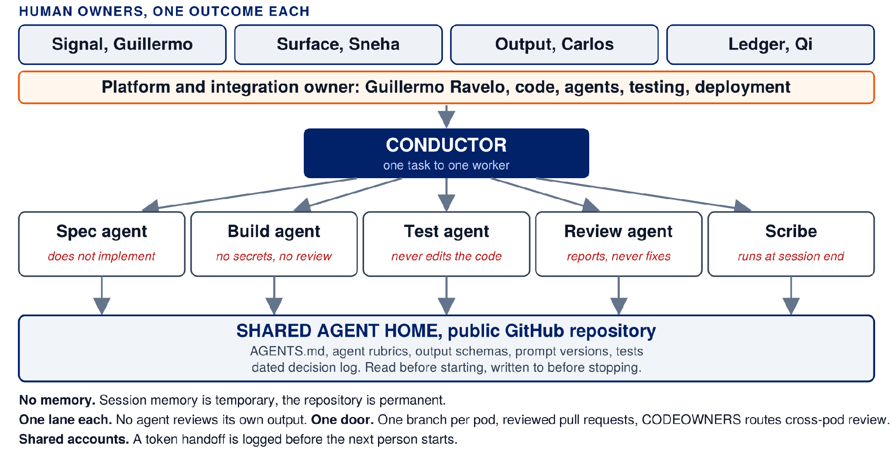
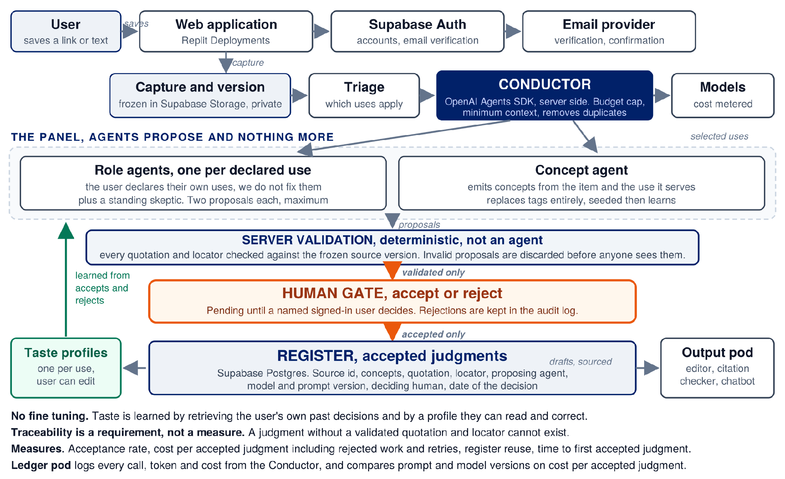

# Shannon · Shared Agent Home

**Team Shannon · PS5200 Part 3 · Final specification, 26 October 2026**  
Guillermo Ravelo · Sneha Sudharsan · Carlos del Rosario · Qi Liu

Shannon turns saved sources into a register of **human-accepted judgments**. Every proposed judgment carries an exact quotation and paragraph locator. Agents propose; the server checks the evidence; a named human decides what enters the register.

**[Read the final assignment](docs/P3-Team-Shannon-v4.pdf)** · **[Browse all 20 agents](agents/README.md)** · **[Shared instructions](AGENTS.md)** · **[Submission checklist](docs/SUBMISSION.md)**

This is a public agent home: anyone, including Paolo and Rajvi, can read and download it without signing in. Visitors do not receive write access. The three-page written specification and the two diagrams on page 4 are preserved from the team's final PDF.

## Start here
1. Read [AGENTS.md](AGENTS.md), your [pod rubric](pods/), and the [dated decisions](operations/DECISIONS.md).
2. Open your agent's instructions in the [roster](agents/README.md). Every definition has inputs, responsibilities, boundaries, an output contract and an acceptance rubric.
3. Use the [schemas](schemas/README.md) and synthetic [examples](examples/) to exchange structured work.
4. Work on a pod branch, request review, and end with a [handoff](operations/HANDOFFS.md).

## Two teams of agents

| Team | Agents | Purpose |
| --- | --- | --- |
| Build crew | Build Conductor, Spec, Build, Test, Review, Scribe | Build Shannon under human ownership, one task to one worker |
| Product pipeline | Triage, Product Conductor, Declared-use Role template, standing Skeptic, Concept | Produce bounded source-grounded proposals and concepts |
| Output pod | Editor, Citation Checker, Register Chatbot | Recover and communicate accepted reasoning |
| Ledger pod | Cost Logger, Evaluator, Version Comparison | Measure spending, outcomes and version changes |
| Surface pod | Copy, Help, Onboarding | Guide signup, review and first value |

Product roles are configured by the user's declared uses, not fixed personas. For the prototype, the four-role limit includes Skeptic: up to three declared-use roles plus Skeptic, two proposals each. Concept output is metadata. Exact quotation validation is code, not another model agent.

## Agent team diagram


## System architecture


Both images were extracted from the final assignment without redrawing their content.

## What is implemented here
- 20 versioned prompt/rubric files and a machine-readable registry.
- Runnable OpenAI Agents SDK definitions with structured outputs and explicit model configuration.
- Deterministic evidence validation, scope checks, bounded panel selection, deduplication and metric helpers.
- Synthetic examples, an offline demonstration and automated contract/behavior tests.
- Final assignment, diagrams, pod ownership, decisions, handoffs and contribution workflow.

The SDK entry point runs an individual agent and returns a proposed artifact or structured result. Build workers have no filesystem or shell tools in this runner. This home is the implementation foundation; the complete authenticated web product and Supabase/Replit integration remain planned work. See [implementation status and integration boundaries](docs/IMPLEMENTATION.md).

## Try it locally
Use Python 3.11 or newer. Run these commands from the repository root:

```sh
python -m venv .venv
source .venv/bin/activate
python -m pip install -r requirements.txt
python -m shannon_home list
python -m shannon_home check
python -m unittest discover -s tests -v
python -m shannon_home demo
```

These checks and the demonstration make no paid model calls. All example sources and decisions are synthetic.

For a live individual agent, set `OPENAI_API_KEY` and `SHANNON_MODEL` in your private server environment, then run:

```sh
python -m shannon_home run spec --input examples/build-task.json
python -m shannon_home run role --input examples/role-input.json
```

Model calls may incur charges. The runner enforces one turn and an output-token limit; a production per-item currency budget requires the server integration described above. Keep credentials and private user data outside this public repository. No model/provider keys are included.

## Human ownership
| Pod | Owner | Outcome |
| --- | --- | --- |
| Signal / platform & integration | Guillermo Ravelo | Source-to-panel quality, code, agents, tests and deployment |
| Surface | Sneha Sudharsan | Signup and first value |
| Output | Carlos del Rosario | Source-linked drafts and chatbot |
| Ledger | Qi Liu | Cost and evaluation |

[Reviewer setup](operations/OWNERSHIP.md) records the current CODEOWNERS bootstrap and outstanding GitHub usernames. Cross-pod work requires the affected human owner's review.

## Planned milestones from the final specification
| Window | Outcome |
| --- | --- |
| 27 Oct–2 Nov | Agree repository/schemas; freeze source paragraphs; connect authentication |
| 3–9 Nov | Run triage/Conductor/roles; enforce quotations; log run failures |
| 10–16 Nov | Human review gate, durable register, cost events and user isolation |
| 23 Nov · Part 4a | Published save → panel → human decision → retrieval after sign-out/sign-in |
| 30 Nov | Editable taste profiles and traceable drafts |
| 7 Dec · Part 4b | Live address, chatbot, help and cost per accepted judgment |
| 14 Dec | Final demonstration, pod measures and held-out replay |

Visual relationship mapping, multi-user sharing, outside integrations, billing and automatic publishing are deferred in the final plan.
